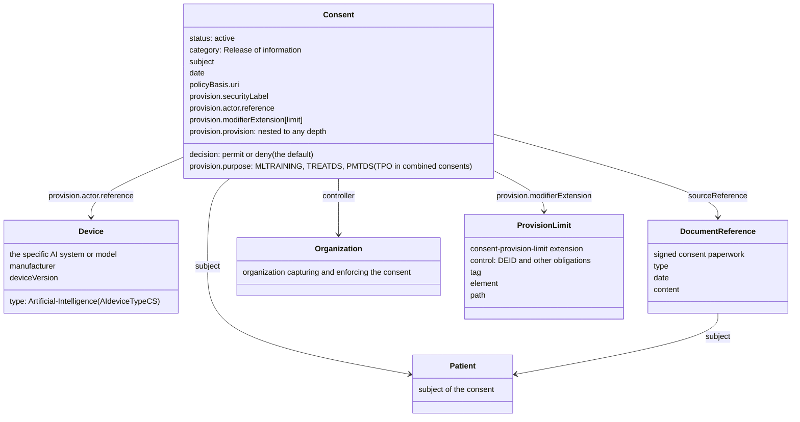

<div markdown="1" class="dragon">

This is an experimental IG. The content is fully from the perspective of the author, and is not endorsed by HL7 or any other organization. It is intended to be a discussion starter, and to solicit feedback from the community.

</div>

Shows how a Consent resource can be used to express permit or deny use of AI for a given patient.

<div markdown="1" class="stu-note">

<br/>
This IG is founded on HL7 FHIR Revision {{site.data.fhir.version}} found at [{{site.data.fhir.path}}]({{site.data.fhir.path}})
<br/>
</div>

### Scope

There are various use-cases where a Patient might consent or dissent to various uses of AI.

1. A patient might consent to use of AI for clinical decision support
2. A patient might deny use of their data for training of AI.
3. A patient might consent to use of their data in de-identified form for training of AI.

Given the Consent model, the Patient might be indicated in a Consent authorizing either

- Generically allowing or denying AI by PurposeOfUse
- Specifically allowing or denying a specific AI by referencing the Device resource for that AI.

A Consent is the healthcare organization's actionable record of the patient's decision. It would carry only rules that an access-control engine can evaluate and that the organization can actually enforce. The signed paperwork that captures the ceremony of the consent remains the authoritative legal record, and is referenced from the Consent.

### Actors

Actors are the abstract technical systems upon which the requirements of this guide are imposed. An Actor is not a human, so the patient is not an Actor. The AI system described by the AI-Device is also not an Actor, as this guide imposes no requirements directly upon it; the requirements fall upon the systems that author, enforce, and request against the Consents.

- [Access Control](ActorDefinition-AccessControl.html) — the technical system given the responsibility to enforce the Consents recorded according to this guide. §AIC-9^AccessControl:The Access Control actor **SHALL** enforce the provisions of the Consents recorded according to this guide, including the PurposeOfUse declared by the requesting system, any specific AI Device identified, and any limits placed upon a permit.§
- [AI-Consent Author](ActorDefinition-AiConsentAuthor.html) — the technical system that records the patient's decisions about AI as Consents conforming to the [Consent about AI](StructureDefinition-ai-consent.html) profile.
- [Data Requester](ActorDefinition-DataRequester.html) — the AI system that directly requests and accesses data.
- [AI Agent](ActorDefinition-AiAgent.html) — the agent (gateway) that accesses data on behalf of an AI, feeding that data to the AI.

Each Actor has a CapabilityStatement describing its technical capabilities: [Access Control](CapabilityStatement-AccessControlCapability.html), [AI-Consent Author](CapabilityStatement-AiConsentAuthorCapability.html), [Data Requester](CapabilityStatement-DataRequesterCapability.html), and [AI Agent](CapabilityStatement-AiAgentCapability.html).

### Resource Model



### Consent about AI Profile

The constraints described in this guide are formalized in the [Consent about AI](StructureDefinition-ai-consent.html) profile. §AIC-1^AiConsentAuthor:A Consent expressing a patient's decision to permit or deny use of AI **SHALL** conform to the Consent about AI profile.§

The profile requires the subject, the date, and the decision carrying the default (permit or deny); each provision is an exception to that default. AI-specific rules are expressed in the `aiProvision` slice on the provisions (root and nested), which is distinguished by a `purpose` from the [AI Purposes Of Use](ValueSet-ai-purposeofuse.html) ValueSet. Within the `aiProvision` slice:

- §AIC-2^AiConsentAuthor,AccessControl:the `aiDevice` actor slice **MAY** identify a specific AI system or model as a Device carrying the Artificial-Intelligence device type§, and
- §AIC-3^AiConsentAuthor,AccessControl:the `limit` modifierExtension **MAY** carry limits, such as an obligation to de-identify, placed on a permit.§

### PurposeOfUse

The most clean method is to use the PurposeOfUse as the basis for the provision in the Consent. This allows the Consent to be independent of the specific AI system or model, and thus not require updates as new AI systems or models are developed. §AIC-4^AiConsentAuthor,AccessControl:When a provision addresses AI use generically, the `provision.purpose` **SHALL** carry the applicable PurposeOfUse code from the [AI Purposes Of Use](ValueSet-ai-purposeofuse.html) ValueSet, such as `MLTRAINING` for training of AI, or `TREATDS` for clinical decision support.§

Further we look to [PurposeOfUse Vocabulary](https://terminology.hl7.org/ValueSet-v3-PurposeOfUse.html) to indicate what the reason the AI is giving for accessing data. For example, the PurposeOfUse of `MLTRAINING` is defined for when an AI is looking to train on data. The PurposeOfUse of `TREATDS` is defined for when an AI is looking to provide clinical decision support, or `PMTDS` when AI is looking to provide analysis for payment decisions.

§AIC-5^DataRequester,AiAgent:Any access by the AI, or by an agent feeding the AI, **SHALL** declare the applicable PurposeOfUse code when accessing data, such as TREATDS, MLTRAINING, or PMTDS.§ This is a trust model that the AI or the agent feeding the AI will accurately indicate the PurposeOfUse when accessing data. However, this is a common trust model used in many other aspects of healthcare data access and thus is not unique to AI.

In FHIR R6 the `Consent.decision` element carries the default action, and each `Consent.provision` is an exception to that default. So a Consent that allows only ML training is expressed as a default of `deny` with a provision naming the `MLTRAINING` purpose, and a Consent that forbids only ML training is a default of `permit` with the same provision.

#### Allow AI for ML Training

```fsh
* decision = #deny
* provision.purpose[+] = $purposeOfUse#MLTRAINING
```

Consent example: [Allow ML Training](Consent-AllowMLtraining.html)

#### Deny AI for ML Training

```fsh
* decision = #permit
* provision.purpose[+] = $purposeOfUse#MLTRAINING
```

Consent example: [Deny ML Training](Consent-DenyMLtraining.html)

#### Allow AI for Clinical Decision Support

```fsh
* decision = #deny
* provision.purpose[+] = $purposeOfUse#TREATDS
```

Consent example: [Allow AI for Clinical Decision Support](Consent-AllowCDS.html)

#### Deny AI for Clinical Decision Support

```fsh
* decision = #permit
* provision.purpose[+] = $purposeOfUse#TREATDS
```

Consent example: [Deny AI for Clinical Decision Support](Consent-DenyCDS.html)

#### Allow AI for Payment Decision Support

```fsh
* decision = #deny
* provision.purpose[+] = $purposeOfUse#PMTDS
```

Consent example: [Allow AI for Payment Decision Support](Consent-AllowPaymentDS.html)

#### Deny AI for Payment Decision Support

```fsh
* decision = #permit
* provision.purpose[+] = $purposeOfUse#PMTDS
```

Consent example: [Deny AI for Payment Decision Support](Consent-DenyPaymentDS.html)

### Specific AI Systems or Models

For this we look to current identification of [AI as a FHIR Device resource](https://build.fhir.org/ig/HL7/aitransparency-ig/StructureDefinition-AI-Device.html). §AIC-6^AiConsentAuthor,AccessControl:When a specific AI system or model is permitted or denied, the Consent **SHALL** identify that AI in `provision.actor.reference` as a Device carrying the Artificial-Intelligence device type, with a provision as an exception to the decision.§ The [Consent about AI](StructureDefinition-ai-consent.html) profile expresses this as the `aiDevice` actor slice within the `aiProvision` slice. Note that the AI-Transparency AI-Device profile is not yet available for FHIR R6, so this guide enforces the Artificial-Intelligence device type coding rather than the profile.

§AIC-7^DataRequester,AiAgent:All data access by the AI **SHALL** be attributed to the FHIR Device describing that AI.§ This might not be the case given how the AI is orchestrated. This model also is fragile as a new model or software would be a new Device, and thus would require a new provision in the Consent to indicate consent or dissent for that new AI.

Device example: [AI Device](Device-AIdevice.html)

#### Allow a specific AI for a specific purpose

In this case there is simply a provision indicating that the AI is permitted for a given purpose. There are no restrictions on the kinds of actions or the kinds of data, but those could be added as additional restrictions.

```fsh
* decision = #deny
* provision.purpose[+] = $purposeOfUse#TREATDS
* provision.actor[0].reference = Reference(AIdevice)
* provision.actor[0].role.text = "CDS"
```

Consent example: [Allow specific AI for specific purpose](Consent-AllowSpecificAIforSpecificPurpose.html)

#### Deny a specific AI for a specific purpose

In this case there is simply a provision indicating that the AI is denied for a given purpose.

```fsh
* decision = #permit
* provision.purpose[+] = $purposeOfUse#TREATDS
* provision.actor[0].reference = Reference(AIdevice)
* provision.actor[0].role.text = "CDS"
```

Consent example: [Deny specific AI for specific purpose](Consent-DenySpecificAIforSpecificPurpose.html)

### Limitations on AI Access

In the FHIR Extension Registry there is a "limit" extension, which is limits placed on a `permit` rule. Where the limit might be an obligation or refrain, might be a specific additional data tag, or might be explicit removal of data elements by `id` or by FHIRPath. A "limit" can not result in exposing data where that limit can't be enforced. Specifically meaning that the recipient of the data needs to be trusted to enforce the obligation or refrain indicated. [Extension Registry Consent Provision Limit](https://build.fhir.org/ig/HL7/fhir-extensions/StructureDefinition-consent-provision-limit.html)

The [Consent about AI](StructureDefinition-ai-consent.html) profile defines a `limit` modifierExtension slice on the `aiProvision` slice at each level of provision nesting.

Example using all the parts of the limit: [non AI example of Consent with Limits](Consent-ex-consent-with-limits.html)

#### Allow AI for ML Training on De-Identified Data

```fsh
* decision = #deny
* provision.purpose[+] = $purposeOfUse#MLTRAINING
* provision.modifierExtension[limit].extension[control].valueCodeableConcept = $obligation#DEID 
```

Consent example: [Allow ML Training on De-Identified Data](Consent-AllowMLtrainingOnDeIdentifiedData.html)

### Combining AI provisions with normal clinical use

FHIR R6 Consent carries the default action in `Consent.decision` and allows many root level `provision` elements, each an exception to that default. A nested `provision` is in turn an exception to the provision that contains it. This makes a mixed Consent much flatter than the equivalent in R4.

```text
decision: deny by default
  permit ML training for de-identified Normal data
    deny ML training for sensitive data
  permit TPO for Normal confidentiality
  permit TPO for the care team including sensitive data
```

Consent example: [Consent with all kinds of Provisions](Consent-AllAiProvisions.html)

The [Consent with provisions three levels deep](Consent-ThreeLevelsDeep.html) example shows a specific AI Device permitted as an exception to a general deny of AI clinical decision support, nesting provisions three levels deep. The [Consent about AI](StructureDefinition-ai-consent.html) profile replicates the AI provisioning at two levels of nesting, which the IG publisher recognizes as applying to any depth of nesting.

Consent example: [Consent with provisions three levels deep](Consent-ThreeLevelsDeep.html)

### Conclusion

The above examples are showing simply how a Consent decision and its provisions can carry permit and deny to indicate consent or dissent for AI. The examples are not exhaustive, and there are many other combinations of provisions that could be used to indicate consent or dissent for AI. The examples are also not indicating any specific data elements that are being allowed or denied, but those could be added as additional restrictions on the provision.

§AIC-8^AiConsentAuthor,AccessControl:The Consent requirements indicated here **MAY** be indicated as a standalone Consent, or the provisions **MAY** be combined with other Privacy Consent requirements.§ A quilted Consent that has various provisions indicating consent or dissent for various clinical use (TPO), and add in provisions indicating consent or dissent for various AI use-cases, and thus have a single Consent that indicates the patient's preferences for both traditional clinical use and AI use.

### Requirements

§§§
